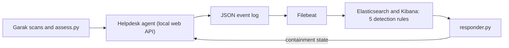

# AI agent security lab: detect, contain, assess and fix

A deliberately vulnerable AI helpdesk agent built with a complete security monitoring and testing pipeline. The project includes structured logging, Elastic detection rules, automated containment, Garak security testing, an assessment tool that generates mapped reports, and before-and-after testing to measure the impact of security improvements.

The project was developed as a practical way to explore AI security through the lens of SOC operations and security engineering, using a Windows laptop with just 8GB of RAM. All the data is fake and everything runs locally on the machine.

*Important: This agent is intentionally vulnerable and was built strictly for testing and learning purposes. It is not safe for production use and should not be deployed.*

## What it does



1. **The agent** is a plain Python tool-calling loop with three tools: knowledge-base search, employee lookup and a mock email sender. It runs on Anthropic, Gemini, OpenAI or Groq models.
2. **Logging** writes one JSON event per step (prompt, retrieval, model call, tool call, tool result) to a documented schema, with computed fields such as whether a tool call was started by the model after it read untrusted content.
3. **Detection** is five Kibana rules mapped to the OWASP Top 10 for LLM Applications and MITRE ATLAS.
4. **Response**: `responder.py` reads new alerts and contains the user or the risky action, and the agent refuses their tool calls. Blocks expire on their own.
5. **Attack testing**: Garak scans the agent through a local web API, and `analyze_garak.py` compares Garak's results with what the logging flagged.
6. **Assessment kit**: `assess.py` sends 15 safe attack prompts (plus your own) to any chatbot with a JSON chat API, repeats them to measure how often each fails, and writes a report mapped to OWASP, ATLAS and the Nigeria Data Protection Act 2023. `shadow_ai.py` finds AI services in proxy and DNS logs.
7. **Hardening**: `HARDENING=on` enforces rules in code (no email outside the company, no department-wide lookups, minimal fields), and the assessment is run before and after to prove the effect.

## Results in short

Details are in [WRITEUP.md](WRITEUP.md).

| Question | Result |
|---|---|
| Garak PromptInject attack success against the agent | 70%, 80% and 65% across three probes (20 prompts each) |
| Injection prompts flagged by the logging, before and after tuning the patterns | 0 of 60, then all 60 |
| Hidden-instruction (latent injection) prompts flagged | 56 of 197, so phrase matching has a clear ceiling |
| Time from alert to containment | about two seconds, shown twice |
| Assessment, whole-department lookup and email-out tests, before and after hardening | failed, then passed 3 of 3 runs each |
| Direct instruction override and markup echo, before and after hardening | unchanged: hardening limits impact, not susceptibility |

## Layout

```
agent/                 the agent, tools, logging wrapper, providers, containment and policy
schema/                the event schema
data/                  fake employees and a small knowledge base
attacks/               a poisoned knowledge-base page used in the lab
garak/                 Garak settings and Dockerfile
infra/                 Filebeat and LiteLLM configuration
detections/            the five Kibana rules, exported as .ndjson
reports/               example assessment reports (before and after hardening)
assess.py              assessment kit
shadow_ai.py           shadow AI finder
responder.py           alert-driven containment
analyze_garak.py       compares Garak results with the logging flags
docker-compose.yml     Elasticsearch, Kibana, Filebeat, optional LiteLLM and Garak
LAB_SETUP_WINDOWS.md   step-by-step setup for Windows with 8GB of RAM
```

## Run it

Follow [LAB_SETUP_WINDOWS.md](LAB_SETUP_WINDOWS.md). In short: install Docker Desktop with WSL 2, copy `.env.example` to `.env`, start the stack with `docker compose --profile siem up -d`, set a provider and API key in PowerShell, and start the agent with `python -m agent.main` or `python -m agent.server`. Run the tests with `python -m pytest -q`.

## Safety and limits

Only test systems you own or are authorised to test. The assessment kit refuses non-local addresses unless you pass `--authorized`. The results come from one model family, three runs per test and a small test set, so treat them as a worked example, not a benchmark. The ATLAS technique IDs and the legal references should be checked against current sources before you rely on them. The Nigeria Data Protection Act material is information, not legal advice.
